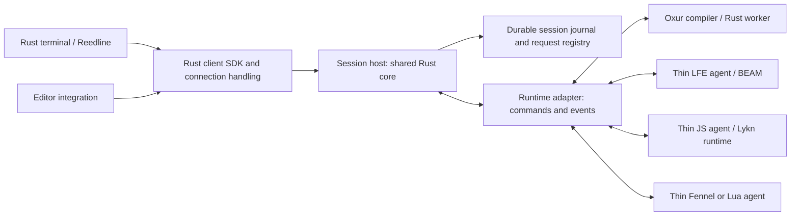

# Shared REPL architecture — research-informed draft

Date: 2026-10-18. Author: Sofie. Status: proposed contract for Operator review.
Requirements R01–R08 in [the initial contract](01-initial-contract.md) are confirmed.
Mechanisms/defaults below are recommendations, including refinements derived from
[research](02-research-round-one.md). Operation names are provisional.

## 1. Architecture and ownership

A long-lived session host outlives terminal/editor connections. It contains the
shared Rust core and gives every session one authority, durable ordered journal
and execution queue. The runtime adapter can live in-process, in a dedicated
worker or within an existing runtime application. The Rust core owns policy;
the runtime agent handles the smallest runtime-specific boundary that works.

The diagram shows logical responsibilities, not compulsory network hops or one
host containing all four adapters. No generic Rust interpreter for these languages
is implied. The initial deployment can choose one adapter per session host.

| Responsibility | Owner | Native language work |
| --- | --- | --- |
| Session identities, admission order, deduplication, close policy | Shared Rust core | Translate native lifecycle observations |
| Journal, durability acknowledgement, replay, cursors, resource budgets | Shared Rust core | Respect capture acknowledgements/backpressure |
| Transport framing, validation, version/capability negotiation | Rust libraries by default | Thin endpoint bridge if runtime serves protocol directly |
| Client demultiplexing and reconnect state | Rust SDK | Small editor binding where necessary |
| Reedline, keymaps/history, prompt/ANSI, display negotiation | Rust terminal | Supply language metadata or providers |
| Parse/compile/evaluate, lexical/compiler context and runtime bindings | Adapter; Rust wherever practical | Native APIs/hooks needed to execute in the runtime |
| Native I/O capture, cancellation hooks, native value handles | Adapter plus Rust bridge | Runtime-specific mechanisms |
| Rich display, completion, inspect/debug/hot reload | Optional capability families | Runtime-specific semantic services |

**Native protocol endpoints remain allowed.** For an embedded BEAM application,
a native listener may forward validated requests/events to a Rust core hosted
via a suitable helper/bridge. That packaging needs a later decision; it is not a
requirement for another public proxy or duplicated public protocol server.
There must still be exactly one admission/journal owner for a session. Rewriting
the common policy/journal in each client language would defeat the Rust-core goal.
A remote adapter must declare what happens when its Rust core connection fails.

The existing synchronous Rust `Backend::handle -> Vec<OutputFrame>` is insufficient
for this contract. The target boundary is an asynchronous command sink plus an
independent event stream and control path. Public Rust traits/signatures remain
undecided; a language VM need not be `Send` or execute on Tokio worker threads.
A dedicated thread/process can own its VM and communicate with the shared core.

The Rust terminal owns configurable keybindings, multiline editing, local command
history, prompt/color and syntax-aware editing. Runtime services can augment local
completion/highlighting without blocking the editor on every keystroke. Prompts
are client presentation, not evaluator output. Preserve xrepl's recorded preference
for buffering asynchronous output while a line is being edited, with a bounded
local spill path; durable reception/cursor processing and safe presentation are
separate concerns. A terminal choice must not block the editor client's delivery.
The exact Reedline integration and version are deferred to implementation.

## 2. Identity and event ordering

Use separate opaque identities for session, runtime generation, authority epoch,
client, attachment and operation. Do not infer identity from a TCP connection,
terminal PID, BEAM atom, process address or human-readable session name.

- Session identity persists through disconnect and archive. A runtime generation
  changes whenever live execution state is replaced. A generation change is
  recorded; clients cannot confuse a fresh runtime with the old heap.
- An authority epoch changes when an exclusive owner is re-established. It is
  distinct from runtime generation: the coordinator can restart while a separate
  runtime survives. V1 requires exclusive local ownership; no automatic remote
  failover. If ownership is uncertain, stop admitting/dispatching work.
- A client-generated operation ID is session-scoped and reusable for recovery.
  Store its canonical semantic payload, including expected runtime generation,
  with the operation record. Same ID/same payload returns the existing operation;
  same ID/different payload returns a conflict without execution.
- Every durable event has `(session_id, sequence)`, with a strictly increasing
  per-session sequence that never resets across runtime generations. Include
  runtime generation, kind, optional operation ID and initiating client ID.
  Authority epoch/provenance accompanies authority/runtime transitions.
- Timestamps assist people; sequence numbers determine authoritative order.
  Order reflects capture/admission at the authority, not universal wall-clock
  ordering among concurrent OS threads, BEAM processes or external systems.

Use an integer representation that round-trips exactly in JS/Lua bindings; decimal
strings or a lossless codec type are candidates. Specify cursor units and text
positions explicitly before a wire schema; avoid accidental JS-number precision
loss or conflating UTF-8 bytes, codepoints and editor UTF-16 positions.

## 3. Admission, execution and request recovery

Normal mutating evaluations serialize per session. Two clients can submit freely;
the authority assigns admission order and both see it. Runtime background work
and runtime-global resources can still race: session serialization is not heap,
module, filesystem or external-effect isolation across the whole application.
Optional read services must declare whether they use a snapshot, run between
evals or can observe concurrent state. They cannot silently mutate outside the
admission rule.

1. Validate capability, identity, generation, authorization and resource bounds.
2. In one transaction, register the operation and append `operation.accepted`.
   Only after durable commit return acceptance. On ambiguous commit/response loss,
   retry/query the same ID; never invent a new ID automatically.
3. Before sending execution to the adapter, durably record `dispatch-intent`.
   This proves it may have started, not that it did. The adapter reports actual
   start when known. Duplicate adapter dispatches must not cause a second run;
   if safe reconciliation is unavailable, leave the operation unknown.
4. Commit captured output/results/outcome before publishing them as durable events.
   Operation outcome is one of succeeded, failed, cancelled, or unknown. Unknown
   means no safe conclusion about effects; later authenticated reconciliation can
   append a resolution rather than edit the old record.
5. Dedup records persist as long as the transcript, including the closed archive.
   They must not expire on connection loss, idle time or a short broker window.

Recovery reconciles a surviving adapter's operation/generation identity, output
capture continuity and exclusive ownership before enabling execution. A timeout
or missing heartbeat proves uncertainty, not runtime death. Never launch a second
worker merely because a remote link is partitioned.

| Durable record at recovery | Action |
| --- | --- |
| Accepted, definitely no dispatch intent | Remains queued; dispatch only if original generation/context survives and no close is pending |
| Dispatch intent, outcome absent | Query surviving adapter; otherwise record unknown and do not retry code |
| Outcome committed | Replay outcome/events; never rerun |
| Runtime generation lost | Expose state-lost; pending work for old generation does not run in the fresh generation |
| Close committed but incomplete | Resume close reconciliation, not evaluation |

No claim of exactly-once external effects is made. Evaluated code can modify a
file/service before the completion record is committed. The protocol has no
transaction with arbitrary effects; deduplication cannot supply that transaction.

## 4. Observation, fanout and catch-up

Each attachment independently asks for events after its highest contiguous
processed sequence. Acknowledgements are delivery bookkeeping, not permission
to delete transcript. A reconnecting client can ask from zero to rebuild its
view; losing a client cursor can cause harmless redelivery, never re-execution.

Use a single read-after algorithm for both history and live data:

1. Register a level-triggered wakeup/watch before reading the journal head.
2. Read a bounded ordered page after the cursor; send only committed events.
3. Advance the delivery cursor through that page and repeat while data exists.
4. At the head, recheck the head/watch version before waiting. Lost notifications
   are repaired by checking durable head again; periodic head checks are allowed.
5. Resume the same loop on wakeup. No separate replay/live ownership transfer.

The processed cursor advances only after the client applied a contiguous prefix.
Within one stream events are ordered; reconnect/retry can deliver duplicates.
Clients deduplicate on session/sequence and detect gaps. A cursor beyond the
committed head or wrong session is an explicit error. Never silently clamp it.
Filtered views must still account for skipped sequence ranges; initially stream
the complete event set and filter presentation locally.

A bounded Tokio broadcast/watch channel may notify journal readers. Overwritten
notifications are not overwritten transcript. Slow clients page from disk or
are disconnected with their cursor intact; no unbounded RAM queue and no global
wait for the slowest client. Eventual catch-up requires the client/network/storage
to become available and its consumption to catch up with production.

## 5. Transcript and durability boundary

The session journal retains accepted source/metadata, operation transitions,
captured stdout/stderr, result previews, diagnostics, input-request metadata and
lifecycle events. It is distinct from local editable command history. Clearing
a terminal display does not remove journal entries. Durable large displays must
retain their referenced content for the transcript lifetime; a live object handle
alone cannot represent a replayable result.

Retain every committed transcript event for the lifetime of the session and,
under the proposed close policy, until explicit archive deletion. Disk spooling
is normal operation, not a truncated ring buffer. Bound memory, frame sizes and
admission rates; if disk policy cannot accept more, reject/pause new work rather
than silently discard old events.

**Complete transcript retention is not capture of bytes that never reached durable
storage.** Runtime/user-space buffers, pipe tails and uncommitted journal batches
can vanish in a runtime/host crash. Never publish such bytes as durable. State
loss or uncertain capture continuity adds a visible boundary and marks the tail
uncertain; if the missing extent is unknown, do not fabricate a byte count.
A healthy runtime whose capture was interrupted may resume only after continuity
is reconciled or the Operator explicitly accepts the recorded gap.

For native acknowledged I/O, reply only after the chosen durable capture boundary;
for OS pipes, the evaluated program's write return does not mean fsync succeeded.
Stronger producer-side recovery needs durable acknowledged spooling, preferably
Rust-owned, and is an optional later profile. Thin agents must not promise lossless
output during arbitrary partitions without such a mechanism.

Storage and fsync choices remain proposals. A local transactional store is a
reasonable demonstrator candidate: operation registry and journal transitions
must commit atomically. If SQLite is selected, WAL/FULL is a candidate default
for host-crash durability, not WAL/NORMAL; local filesystem/VFS and power-loss
behavior still need validation. See [research S06/S07](02-research-round-one.md).
External blob storage adds a second crash-consistency problem; keep small bounded
payloads transactional in the first demonstrator.

Input secrets require an explicit exception: log prompt identity, ownership,
reply occurrence and redaction metadata, never password contents by default.
Arbitrary evaluated source/output can still contain secrets. Storage permissions,
access checks and deletion policy must reflect that. Ordinary program input may
be recorded; secret input is intentionally not replayable as content. Reconnect
replays observations and does not need secret content to re-execute anything.
This privacy policy is proposed and needs Operator agreement.

## 6. Operation and capability surface

All names are provisional. A common core must be small; do not require all 83
historical xrepl protocol operations or Oxur's language-specific mode enum.

| Family | Proposed operations | Contract |
| --- | --- | --- |
| Discovery | hello / describe | Versions, capabilities, limits, adapter/runtime identity and failure domains |
| Sessions | create / list / inspect | Stable IDs; current generation, lifecycle and capture continuity |
| Attachments | attach / detach | Cursor-based observation; detach never closes runtime/session |
| Evaluation | submit / operation.inspect | Source plus provenance, expected generation and stable operation ID |
| Events | read / follow / processed-cursor | One complete ordered durable event stream with replay |
| Control | cancel / session.close / close.inspect | Responsive while evaluation runs; acknowledge request separately from outcome |
| Archives | archive.read / archive.delete | Closed read-only transcript; deletion explicit and separately authorized |
| Runtime management | runtime.restart / runtime.shutdown | Administrative capability, target and impacted sessions explicit |
| Optional program input | prompt.assign / input.reply | Prompt ID and responder epoch, one accepted reply |
| Optional language services | completion / lookup / inspect / format / highlight / debug / load-file | Advertised by family; mutating operations follow admission/generation rules |
| Optional state services | checkpoint / restore / clone | Adapter-specific scope and limitations; never inferred from transcript replay |

Core support for cancel means the request has a defined response. The adapter
may report unsupported, cooperative-only, session-destructive or runtime-wide
cancellation. Killing execution must never be silently substituted for safe
interruption. Load-file replay needs the exact admitted content/version, not a
later read of a mutable path. Debug evaluation or hot reload cannot bypass the
same effect/ordering model just because it is an extension.

Errors are structured and distinguish unsupported operation, invalid input,
conflicting ID, stale generation, unauthorized action, unavailable storage,
unknown outcome, state loss and incomplete close. A user-code exception is an
operation failure; a protocol/storage failure is infrastructure failure.

## 7. Program input and late output

Foreground completion commits the returned values/error and operation outcome.
It is not proof that timers, tasks or descendants have stopped producing output.
Late output retains its originating operation when attribution is known; otherwise
it is session/runtime output with explicit attribution uncertainty. Do not guess
that the most recent operation caused it. Multi-value results preserve their
count/order, including nil/false/undefined distinctions, through adapter previews.

For program input, create a prompt ID scoped to session/generation and optionally
operation, with a designated attachment and responder epoch. Default proposal:
the submitting attachment owns its prompt. Other clients see pending prompt
metadata. Reassignment after disconnect is explicit; never automatically broadcast
stdin ownership. First valid reply for the assigned epoch wins; duplicate/stale
replies cannot supply a second input. With no responder, remain visibly waiting
until configured timeout, explicit reassignment, cancellation or close. Do not
treat a transport disconnect as stdin EOF unless that is explicitly requested.

## 8. Failure and durability matrix

Assumption: one host-local authority, healthy persistent storage honoring its
configured durability boundary, no replication promise. Actual runtime placement
defines the blast radius; report whether an agent, session worker, runtime or
several sessions share a failure domain.

| Failure/action | Records/transcript | Live execution state | Required behavior |
| --- | --- | --- | --- |
| Terminal/editor disconnect or crash | Retained | Survives if runtime healthy | Accepted work continues; reconnect by cursor; unsubmitted text is client-owned |
| Slow consumer / fanout overflow | Retained | Unaffected | Read journal from cursor or disconnect attachment; do not drop transcript |
| Client-to-host partition | Retained | May continue | Client sees uncertainty; retry/query same ID, no automatic alternate authority |
| Runtime-agent link loss, runtime may live | Committed prefix retained | Unknown until reconciled | Freeze new dispatch, bound capture buffers/backpressure; expose continuity uncertainty |
| Rust authority crash, separate runtime alive | Durable commits retained | May survive | Establish exclusive ownership, reconcile operation/capture state before resuming |
| Agent crash inside runtime | Durable commits retained | Depends on adapter placement | Declare actual state/capture loss; avoid generic claim runtime survived |
| Worker/runtime crash | Durable commits retained | Lost in affected failure domain | Record generation/state loss; uncertain active work is not rerun |
| Host power loss | Durable commits survive if configured storage honors sync | Normally lost | Recover records; expose state loss and uncertain tail; explicit new generation |
| Storage full/write/fsync failure | Prior healthy committed prefix retained | May still be running | Stop admission/dispatch; backpressure capture, bounded cancel/suspend if possible; no false acceptance |
| Corrupt/lost disk | May be unreadable or lost | Independent, possibly alive | Fail visibly, no claim of complete replay; backup/replication is separate work |
| Explicit detach / terminal EOF | Retained | Continues | End only this attachment; no last-client garbage collection by default |
| Explicit session close | Retained, then sealed archive | Owned state/resources released on successful close | Follow barrier below; shared peers remain alive |
| Explicit archive deletion | Deleted according to documented scope | Session already closed | Revoke access first, delete records/blobs/dedup; physical erasure/backups are distinct guarantees |
| Explicit runtime shutdown | Journals retained | Lost for every hosted session | Enumerate impact; use administrative lifecycle operation, never hide behind detach |

If storage is unavailable even the fault event may not be commit-able. Surface
an out-of-band fault/status immediately; do not claim it is durable. On recovery,
commit the uncertainty boundary before accepting more evaluations. A reserved
metadata space may help but cannot guarantee success on a failed device.

## 9. Explicit close, archive and deletion

Recommended default: close terminates live session use and keeps a read-only
archive until explicit deletion. It does not checkpoint the heap automatically.
Attach grants do not imply close/delete authority. Multiple authorized clients
can request close; deduplication and one lifecycle owner make retries coherent.

1. Durably transition to `closing`; reject new evaluation admission. Submit/close
   races are resolved at the same authority: either eval was admitted first and
   gets a final disposition, or close wins and eval is rejected.
2. Mark queued, undispatched operations cancelled. Request cancellation of active
   work; continue accepting control/inspection and capturing output while waiting.
3. Quiesce the session's owned producers and execution resources. Obtain adapter
   confirmation covering foreground execution, managed background tasks and I/O
   drain. Preserve ordering between final producer events and the barrier.
4. Commit final operation outcomes and `session.closed(final_sequence, reason,
   resource_disposition, transcript_continuity)` as the last event. Seal archive.
5. Notify all attachments. Archive readers may reconnect; mutation is rejected.

A bounded wait expiring yields `closing` with an incomplete-close reason; it
never means cancelled/closed. Force-stop is available only when its failure
domain is allowed: a dedicated session worker may be terminated with explicit
state-loss semantics; a shared runtime kill requires the separate administrative
operation naming affected sessions. A future explicit abandon policy could
release unmanaged resources, but is not an implicit successful close here.

Arbitrary file writes, application-global processes and external effects are
not rolled back. Adapters declare their ownership boundary. Successful close
ends managed session producers and intake; it cannot promise to undo or terminate
untracked external activity. Late events after the confirmed barrier are rejected
from the sealed journal and become infrastructure diagnostics, not new entries
silently appended to the archive. An adapter unable to establish its claimed
barrier must report incomplete close.

Closed session IDs are not reused or reopened for execution. A fresh session can
link to its archive; explicit checkpoint restoration, if supported, gets distinct
provenance. Archive deletion removes the request registry too, so tombstone/ID
policy must prevent a stale retry from recreating the old session. Never create
an unknown session implicitly during submit/attach.

## 10. Remaining decisions before implementation

- Public project/repository name, crate names and delivery home.
- Concrete codec/schema evolution, framing limits and text-position conventions.
- Local journal choice, fsync/group-commit policy, storage layout and permissions.
- Endpoint/Rust-core packaging for embedded BEAM and foreign runtimes.
- Lykn persistent compiler context and JS execution API; supported Deno/Lua hosts.
- Per-adapter cancellation, resource ownership and capture-continuity capabilities.
- Numeric queue/storage limits, close wait defaults, input reassignment/timeout,
  and secret-input retention exception.

Automatic distributed failover, consensus, transparent heap restoration and a
broker dependency are outside the first demonstrator. The initial exclusive
owner must still be enforced, not merely documented. A local single writer lock
plus no concurrent replacement dispatch is the intended scope; remote takeover
would require a separate fencing/coordination design.
